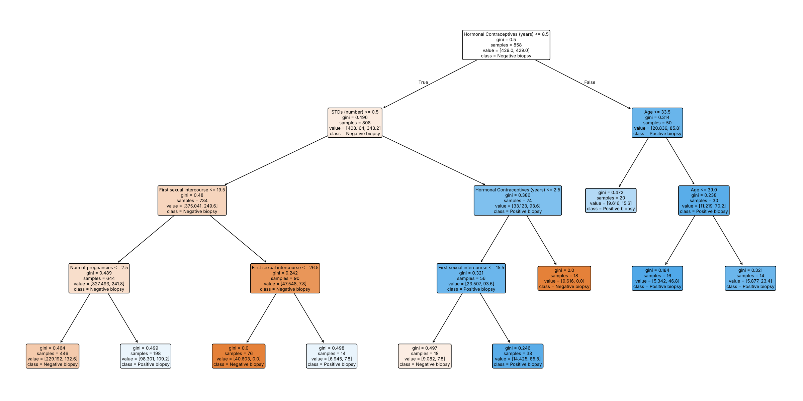

# Cervical Cancer Risk Factors: A Machine Learning Demo

A Streamlit web app and training pipeline that predicts biopsy outcomes from self-reported
risk factors, built as part of an Inspirit AI project.

> **Not a medical tool.** This is an educational project. The model is weak and must not be
> used to make health decisions.

## What it does

- `train.py` evaluates a decision tree with 5-fold stratified cross-validation, compares it
  with a random-guess baseline, and saves the trained model, metrics and a plot of the tree.
- `app.py` is a Streamlit app where a user enters their risk factors and sees whether their
  answers resemble those of patients with a positive biopsy, along with the model's
  evaluation results.

## Data

[Cervical Cancer (Risk Factors)](https://archive.ics.uci.edu/dataset/383/cervical+cancer+risk+factors)
from the UCI Machine Learning Repository: 858 patients from Hospital Universitario de
Caracas, Venezuela. Missing answers (recorded as `?`) are filled with the training-set
median.

- **Target:** `Biopsy` (55 positive, 803 negative, so about 6% positive).
- **Features:** age, number of sexual partners, age at first intercourse, number of
  pregnancies, years smoking, years using hormonal contraceptives, years using an IUD, and
  number of STDs diagnosed.

Columns that are themselves diagnoses or screening results (`Dx:*`, `Hinselmann`,
`Schiller`, `Citology`) are deliberately excluded. Including them leaks the answer into the
model and produces misleadingly high accuracy.

## Results

5-fold stratified cross-validation (mean ± standard deviation):

| Metric            | Decision tree | Random-guess baseline |
|-------------------|---------------|-----------------------|
| ROC-AUC           | 0.57 ± 0.11   | 0.51                  |
| Recall            | 0.35 ± 0.16   | 0.09                  |
| Precision         | 0.16 ± 0.10   | 0.09                  |
| Balanced accuracy | 0.58 ± 0.10   | 0.51                  |

Plain accuracy is not reported as the main metric: because only 6% of patients are
positive, a model that always says "negative" scores about 94% accuracy while being
useless.

**Takeaway:** self-reported risk factors on their own carry only a weak signal for biopsy
outcome. The model beats random guessing but misses about two in three positive cases,
which is why screening tests matter.



## Lessons learned

An earlier version of this project reported over 95% accuracy. That number came from
two problems, both fixed here:

1. **Target leakage.** The target was `Dx` ("any diagnosis"), and the features included
   `Dx:Cancer` and `Dx:CIN`, which almost completely determine it.
2. **Class imbalance.** Accuracy looked high because almost every patient is negative.

## Run it locally

Requires Python 3.10 or newer.

```bash
pip install -r requirements.txt
python train.py        # optional: regenerates metrics.json and figures/tree.png
streamlit run app.py
```

## Project structure

```
app.py          Streamlit app
model.py        data loading, feature list and model pipeline
train.py        cross-validated evaluation and training
metrics.json    saved evaluation results
figures/        decision tree plot
```

## Possible next steps

- Try models better suited to small, imbalanced data (e.g. logistic regression, random
  forest) and tune the decision threshold for higher recall.
- Report confidence intervals with repeated cross-validation.

## Acknowledgements

Dataset: K. Fernandes, J. S. Cardoso and J. Fernandes, "Transfer Learning with Partial
Observability Applied to Cervical Cancer Screening", *Iberian Conference on Pattern
Recognition and Image Analysis*, 2017. Made available via the UCI Machine Learning
Repository under a CC BY 4.0 licence.
